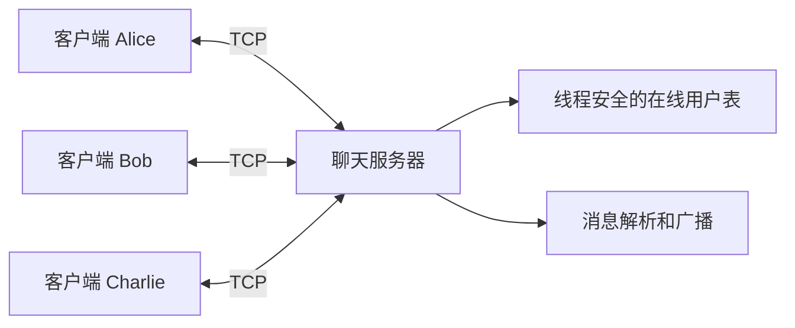
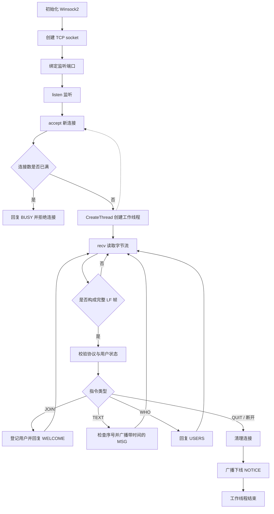
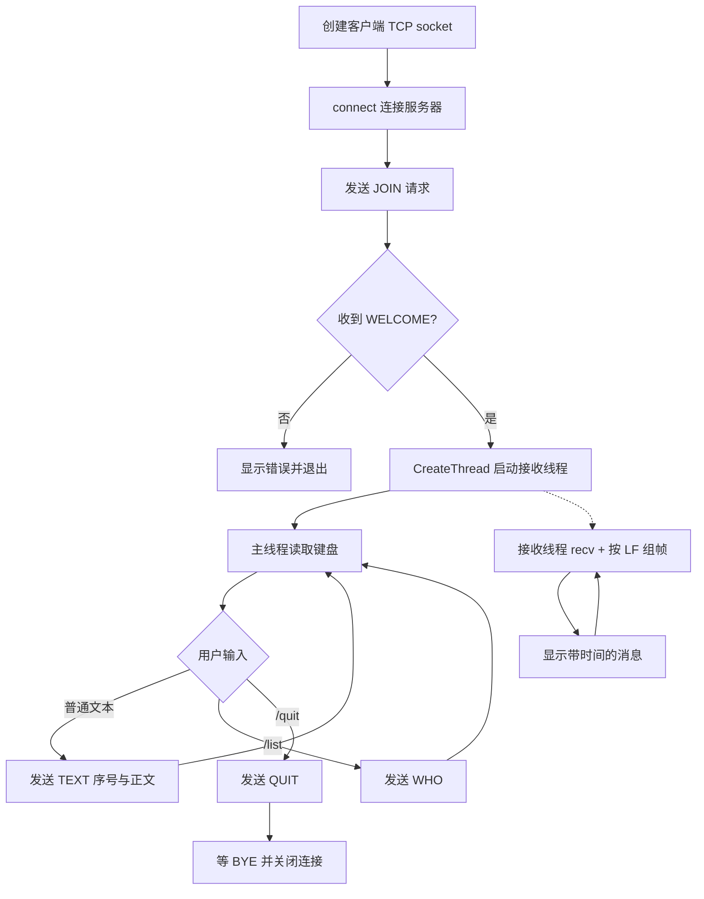
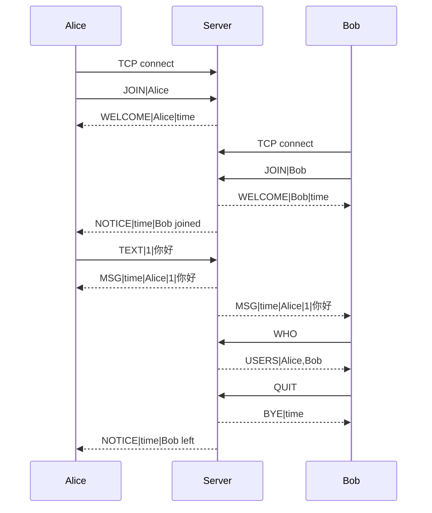

# TCP 多线程聊天室系统设计

## 1. 总体模型

客户端与服务端采用 C/S 模式。服务端拥有固定监听端口，所有客户端与服务端各自维护一条独立的 TCP 连接，客户端之间不直接建立连接。服务器转发文本消息实现公共聊天室。该模型对应课程第二章 2.1 节的客户/服务器通信模型。

## 2. 模块划分

| 模块 | 代码位置 | 功能 |
|---|---|---|
| Socket 服务端 | `server.cpp/main()` | WSAStartup→socket→bind→listen→accept，等待连接 |
| 单连接工作线程 | `server.cpp/client_worker()` | `CreateThread`，处理收到的完整帧、客户端异常关闭 |
| 登录和用户管理 | `server.cpp/handle_frame()、handle_join()` | 校验昵称、维护线程安全用户表、回复 WELCOME/USERS |
| 广播 | `server.cpp/broadcast()` | 获取用户列表快照，向各用户独立 `send_all` |
| 客户端输入线程 | `client.cpp/main()` | 读取 Windows Unicode 输入并将普通文本编码为 TEXT |
| 客户端接收线程 | `client.cpp/receiver()` | 从 Socket 读流、提取协议消息、显示时间/昵称/内容 |
| 协议工具 | `protocol.cpp` | 完整发送、行分帧、UTF-8 校验、整数解析、时间格式化 |
| 平台辅助头文件 | `net_platform.h` | 引入 Winsock2 和系统基础函数，仅做条件编译，不封装 Socket 对象 |

补充图形界面模块：`src/gui_client.cpp` 使用 Win32 `CreateWindowExW` 原生控件、`wWinMain` 消息循环和 `CreateThread` 接收线程；接收线程借助 `PostMessageW` 通知 UI 线程更新消息区，未采用第三方 GUI 体系或 Socket 封装类。命令行客户端仍保留用于基本函数调试和备用演示。

## 3. 服务端流程图

## 4. 客户端流程图

## 5. 消息交互时序图

## 6. 并发处理与资源管理

服务端主线程循环调用 accept。每接入一个客户端，Windows 通过 `CreateThread` 创建一个新的工作线程；该线程持续接收来自对应客户端的字节流。用户表是 `map<string, shared_ptr<Session>>`，由 `users_lock` 保护。广播前只在锁内复制在线用户快照，随后释放全局锁再执行网络 I/O，避免慢连接持有全局锁；各连接单独维护 `send_lock`，避免多个工作线程向同一 TCP 连接写入不同帧时产生字节交错。

对 `recv()==0`、负值和对端主动退出都做清理。工作线程结束时移除注册用户、关闭 Socket、通知其他用户。连接数限制 64，在线用户上限 32，避免教学服务器无限制创建线程。

## 7. 需要在 Windows 实机核验的点

Windows 32/64 位 MSVC 编译、控制台中文输入输出、主动退出的 BYE、`CreateThread` 线程生命周期、Wireshark/Npcap 捕获完整握手，均需实际运行后才能在实验报告中标注为已完成。
